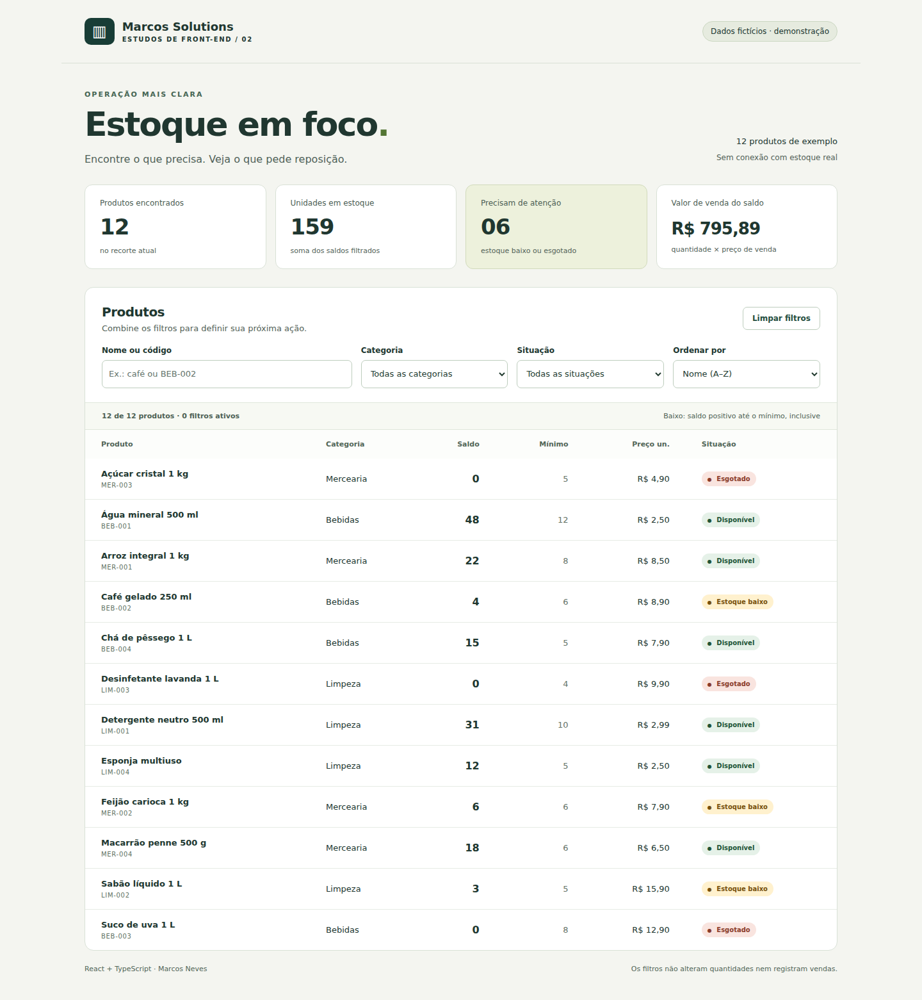

# Estoque em Foco

A small React + TypeScript inventory filtering demo for Marcos Neves / Marcos Solutions.

**Business problem:** staff need to find items that require replenishment without inspecting an entire inventory list. This one-week exercise combines search, category and stock status while keeping the summary consistent with the visible products.



[Watch the real browser recording](media/estoque-em-foco.mp4) · [Filtered state](media/02-filtros.png) · [Empty state](media/03-vazio.png) · [Mobile screenshot](media/04-mobile.png)

## Run locally

Install Node.js 24 or newer. Clone the repository and enter the project directory:

```bash
git clone https://github.com/Santoszoi/estoque-em-foco.git
cd estoque-em-foco
npm ci
npm run dev
```

Open the URL printed by Vite, normally `http://127.0.0.1:5173`. Do not open index.html directly or use Live Server. The interface uses Brazilian Portuguese. No account, database, secret or environment variable is required.

## Demo script

1. Choose **Bebidas** and **Estoque baixo**.
2. Search for `CAFE`. The single matching item is Café gelado, even without an accent.
3. Confirm the summary follows the filtered data: 1 product, 4 units, 1 item needing attention, R$35.60 in sales value.
4. Search for `inexistente` to see the empty state.
5. Use **Limpar e buscar novamente** to reset all controls and focus the search input.
6. Sort by **Menor saldo** to see zero-stock products first.

All 12 records are fictional. Nothing changes stock levels or places orders. Reloading resets filters. Prices and totals represent sales value of the stock, not profit, cost or revenue already earned.

## Features

- Search by product name or SKU with case/accent normalization.
- Multiple search terms are AND-combined, independently of term order.
- Text, category and status filters compose with AND semantics.
- Name sorting or ascending stock with deterministic name/ID tie-breaking.
- Derived metrics for the selected results, calculated using integer cents.
- Explicit zero-stock and minimum-stock boundary rules.
- Actionable empty state and reset with focus restoration.
- Native controls, visible focus, labels, live result count and semantic table headers.
- Responsive filters; a horizontally scrollable table with a labeled, keyboard-focusable region on narrow screens.

## Business rules

| Rule | Result |
| --- | --- |
| Stock is zero | Esgotado (out of stock) |
| Stock is positive and less than or equal to minimum | Estoque baixo (low stock) |
| Stock is above minimum | Disponível (available) |
| Needs attention | Low stock or out of stock |
| Stock sales value | Sum of stock × unit sales price in cents |

Zero is checked before the minimum threshold. Statuses are mutually exclusive. The dataset assumes valid, non-negative integer quantities and prices; incoming API data would need runtime validation.

## Structure and decisions

```text
src/
  stock.ts       Pure filtering, normalization, classification and summary rules
  data.ts        Read-only typed fictional fixtures
  App.tsx        Controlled filters, derived results and semantic presentation
  main.tsx       React entry point
  styles.css     Responsive layout and visible focus
  vite-env.d.ts  Vite client types
tests/
  filter.test.ts Business rule and boundary tests
  stock.spec.ts  Browser flows and axe scans
scripts/
  capture.mjs    Real screenshot and recording workflow
```

Only filters are stored as React state. Results and metrics are derived during render, avoiding duplicate state and synchronization effects. Twelve records do not justify debouncing, virtualization, a global state library or memoization. Filtering creates a new array before sorting, so the original data remains untouched. Stable product IDs identify rows.

Search normalizes accents and case and checks every query term against combined name/SKU text. It is substring matching, not fuzzy search, typo correction or full-text search. Sorting uses pt-BR collation; exact collation can vary across runtimes. A tie-break by ID makes identical names deterministic.

HTML inputs and selects retain native keyboard behavior. Updating results does not move focus. Explicit reset moves focus to search. Counts are announced using a polite status region; this may become verbose during typing and needs manual screen-reader evaluation. Status is expressed with text as well as color.

The table intentionally scrolls horizontally on mobile instead of hiding columns. Page-level overflow is tested separately from the table's own scrolling. The demo is read-only, so it does not handle inventory concurrency or persistence.

## Verify

```bash
npm test
npm run build
npx playwright install chromium
npm run test:e2e
```

On Linux CI, install browser dependencies with `npx playwright install --with-deps chromium`. A prepared GitHub Actions workflow runs unit tests, build and browser checks. It has **not** been executed on GitHub in this delivery.

Actual local results and environment are recorded in [VALIDATION.md](docs/VALIDATION.md), with [unit output](docs/unit-test-output.txt), [build output](docs/build-output.txt) and [browser output](docs/browser-test-output.txt).

Automated accessibility scans do not establish WCAG conformance. Manual NVDA/VoiceOver, real devices, Firefox, Safari, high contrast and actual browser zoom remain unverified.

## Media

Screenshots and the video show the running app, using scripted interactions and pauses for readability. They are not generated mockups or performance benchmarks. The MP4 is silent and has no watermark.

To reproduce, run `npm run build`, start `npm run preview -- --port 4173` in another terminal, then:

```bash
npx playwright install chromium ffmpeg
node scripts/capture.mjs
ffmpeg -i media/estoque-em-foco.webm -vf "scale=960:-2,fps=30" -c:v libx264 -profile:v baseline -level:v 3.1 -pix_fmt yuv420p -movflags +faststart media/estoque-em-foco.mp4
```

FFmpeg is required only for conversion. This execution used a separate Chromium executable supplied through `CHROMIUM_PATH` because the normal browser download failed. Standard environments can omit that variable.

## Scope and next steps

No API, authentication, database, stock mutations, export, pagination, persistent filters or production deployment is included. The TypeScript types do not validate untrusted runtime inputs. For a large catalog, move filtering/pagination to a validated server API, define response/error contracts and handle stale requests. These are future work, not existing capabilities.

This project focuses on selecting stock items. It is different from a complete POS system or the previous support request form exercise.

[Five-day study guide](docs/ROTEIRO-5-DIAS.md) · [Portuguese LinkedIn draft](docs/LINKEDIN.md) · [Publishing checklist](docs/PUBLICAR.md)

Prepared for review. No GitHub, LinkedIn or hosting publication was made automatically.
